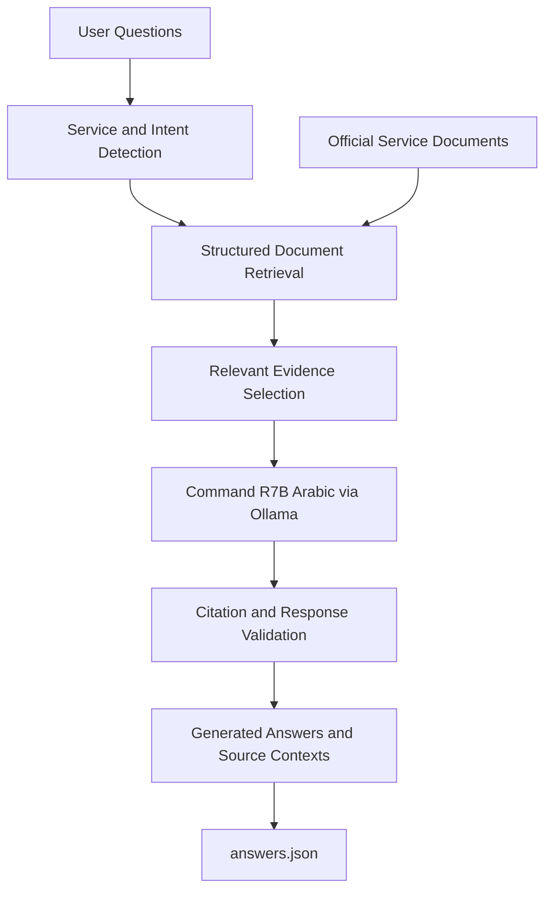

# BURHAN
### Offline Evidence-Grounded Government Services Assistant

BURHAN is an offline, evidence-grounded AI assistant designed to provide accurate and reliable information about government services. It uses the **Command R7B Arabic** language model through Ollama to interpret natural language questions, retrieve relevant information from official documentation, and generate answers supported by verifiable source excerpts.

The system focuses on factual accuracy, document relevance, Arabic language understanding, and conversational continuity while operating entirely on local hardware.

## Overview

Government service documentation often contains complex procedures, eligibility conditions, varying fees, and exceptions. Finding accurate answers can require navigating multiple documents and interpreting details specific to an individual's circumstances.

BURHAN addresses these challenges through a lightweight retrieval-augmented generation (RAG) architecture that combines structured document retrieval with local language model inference.

The knowledge base contains **12 government services** across three categories:

- Passports
- Family Books
- Smart Identity Cards

Each category includes first-time issuance, renewal, lost document replacement, and damaged document replacement.

## Core Features

**Evidence-Grounded Answers**

Responses are generated using relevant excerpts retrieved from the supplied documentation. Supporting source contexts are included alongside each answer.

**Service-Aware Retrieval**

Identifies the relevant government service and operation, distinguishing between similar procedures to reduce incorrect document selection.

**Contextual Reasoning**

Handles conditional fees, eligibility requirements, supporting documents, exceptions, and information distributed across multiple document sections.

**Arabic Language Understanding**

Supports formal Arabic, Jordanian dialect, common expressions, and variations in how users describe government services.

**Multi-Turn Conversations**

Maintains conversational context across related questions while isolating independent chat sessions.

**Uncertainty Handling**

Distinguishes between supported information, ambiguous requests, and questions outside the available knowledge base.

**Offline Execution**

Operates through a local Ollama instance without requiring cloud inference services, external APIs, or internet connectivity during execution.

## System Architecture



### Processing Pipeline

1. **Document Processing:** Parses the nine structured sections of each service document.
2. **Intent Identification:** Determines the requested service, operation, and information type.
3. **Evidence Retrieval:** Selects relevant passages, including applicable conditions and exceptions.
4. **Answer Generation:** Sends the question and retrieved evidence to the local language model.
5. **Response Validation:** Checks returned evidence identifiers and prepares supporting contexts.
6. **Output Generation:** Produces structured JSON responses while preserving conversation history and input identifiers.

The system does not require model fine-tuning or a separate vector database.

## Technology Stack

| Component | Technology |
|---|---|
| Language | Python |
| Language Model | Command R7B Arabic 7B |
| Inference Runtime | Ollama |
| Retrieval | Service-aware structured retrieval |
| Knowledge Base | Local text documents |
| Interface | Command-line batch processing |
| Output Format | UTF-8 JSON |
| External Python Dependencies | None |

## Project Structure

```text
BURHAN/
├── main.py
├── data/
│   └── 12 government service documents
├── examples/
│   ├── questions_sample.json
│   └── answers_example.json
├── scripts/
│   ├── check_output.py
│   └── audit_contexts.py
├── README.md
├── JUDGE_DEMO.md
└── SUBMISSION_CHECKLIST.md
```

## Execution

BURHAN uses a standardized batch-processing interface compatible with the evaluation requirements.

**Required model:** `command-r7b-arabic:7b`

```powershell
ollama pull command-r7b-arabic:7b
```

**Application execution:**

```powershell
python main.py questions.json
```

The application processes every conversation and writes the results to `answers.json` in the project directory.

Each message retains its original identifiers and question while receiving two additional fields:

- `answer`: The generated response.
- `contexts`: Source excerpts supporting the response.

### Configuration

Optional environment variables control inference parameters:

```powershell
$env:OLLAMA_MODEL = "command-r7b-arabic:7b"
$env:BURHAN_NUM_CTX = "6144"
$env:BURHAN_MAX_TOKENS = "500"
```

## Evaluation and Testing

BURHAN supports local testing through the supplied sample questions and validation utilities.

```powershell
python main.py --inspect
python main.py examples/questions_sample.json
python scripts/check_output.py examples/questions_sample.json answers.json
python scripts/audit_contexts.py examples/questions_sample.json answers.json
```

The evaluation focuses on:

- Factual correctness and conditional reasoning
- Accurate retrieval of supporting information
- Consistency between answers and source contexts
- Conversational context retention
- Appropriate handling of ambiguous and unsupported questions
- Reliable execution and valid JSON output

Automated structural and citation checks supplement factual evaluation but do not guarantee semantic correctness.

## Design Principles

BURHAN follows four core principles:

1. **Accuracy First:** Prioritize correct, context-specific information over unnecessarily detailed responses.
2. **Evidence Over Assumptions:** Ground responses in the supplied documentation rather than unsupported model knowledge.
3. **Efficiency by Design:** Retrieve focused evidence instead of processing the entire knowledge base for every question.
4. **Local and Reproducible:** Maintain a lightweight, self-contained architecture with deterministic document processing and locally executed inference.

## Documentation

Additional project documentation is available in:

- [`JUDGE_DEMO.md`](JUDGE_DEMO.md): System demonstration and evaluation workflow.
- [`SUBMISSION_CHECKLIST.md`](SUBMISSION_CHECKLIST.md): Deployment readiness and submission verification.

## Project Scope

BURHAN is a document-grounded information assistant developed for the **AI Future 26 Hackathon at 42 Irbid**.

It uses the supplied government service documentation as its knowledge source. The system is intended to demonstrate reliable retrieval and AI-assisted question answering, not to replace official government authorities or independently verify the current validity of administrative policies.

---

**BURHAN | Reliable Answers. Verifiable Evidence. Local Intelligence.**
